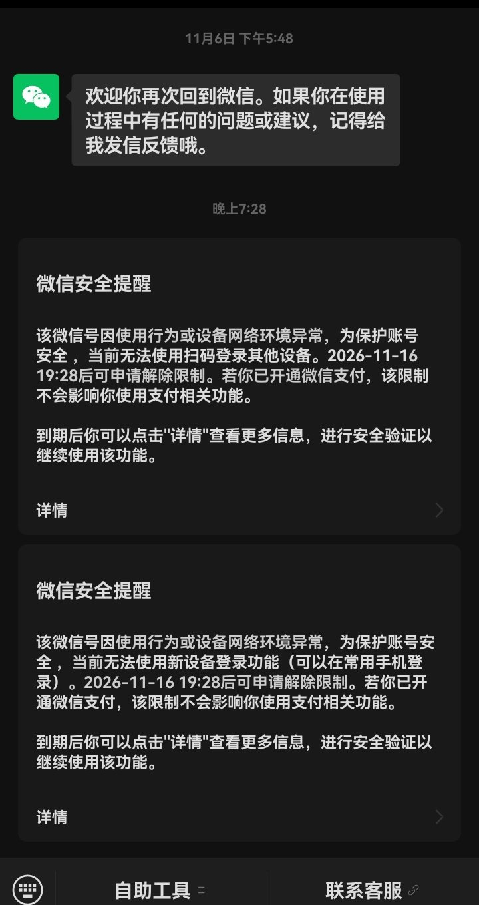

# 微信账号安全限制事件（2026-11-09）

> 状态：已脱敏事故记录。  
> 本记录不包含微信号、手机号、二维码、昵称、聊天内容或设备标识。

## 1. 事件

- 发现时间：2026-11-09 19:30 左右；
- 现象：微信提示账号因“使用行为或设备网络环境异常”被安全限制；
- 限制内容：
  - 无法使用扫码登录其他设备；
  - 无法使用新设备登录功能；
  - 常用手机仍可登录；
  - 微信支付不受影响。

## 2. 微信提示原文（摘录）

```text
微信安全提醒

该微信号因使用行为或设备网络环境异常，为保护账号安全，
当前无法使用扫码登录其他设备。
2026-11-16 19:28 后可申请解除限制。
若你已开通微信支付，该限制不会影响你使用支付相关功能。

到期后你可以点击“详情”查看更多信息，进行安全验证以继续使用该功能。

微信安全提醒

该微信号因使用行为或设备网络环境异常，为保护账号安全，
当前无法使用新设备登录功能（可以在常用手机登录）。
2026-11-16 19:28 后可申请解除限制。
若你已开通微信支付，该限制不会影响你使用支付相关功能。
```

脱敏截图：



## 3. 影响

- PC 扫码登录不可用；
- 自动化采集/真实发送立即停止；
- 本地群库与历史数据不受影响；
- 未继续尝试登录、未使用第三方解封服务。

## 4. 已采取措施

- [x] 停止所有采集/监听/自动发送进程；
- [x] 禁用自动采集计划任务；
- [x] 不反复扫码、不换设备登录；
- [x] 不卸载重装、不使用第三方解封；
- [x] 保留本地数据与日志；
- [x] 记录本事件，等待官方解除入口。

## 5. 原因判断

微信只给出“使用行为或设备网络环境异常”，未指明具体原因。

可能相关因素：

- 桌面 RPA/自动化操作；
- 多设备/网络环境变化；
- 短时间内的真实发送/登录行为。

以上只是复盘假设，不是微信官方结论。

## 6. 后续

- 在 2026-11-16 19:28 后通过微信官方“详情”入口做安全验证；
- 不通过第三方“解封”服务；
- 测试必须使用独立测试账号，不使用主账号；
- 真实发送长期保持关闭；
- 恢复后先只读、低频、人工在环验证。

## 7. 复现边界

本项目不提供绕过账号限制、伪造设备、规避风控的方法。  
此记录仅用于事故复盘与合规使用提醒。
